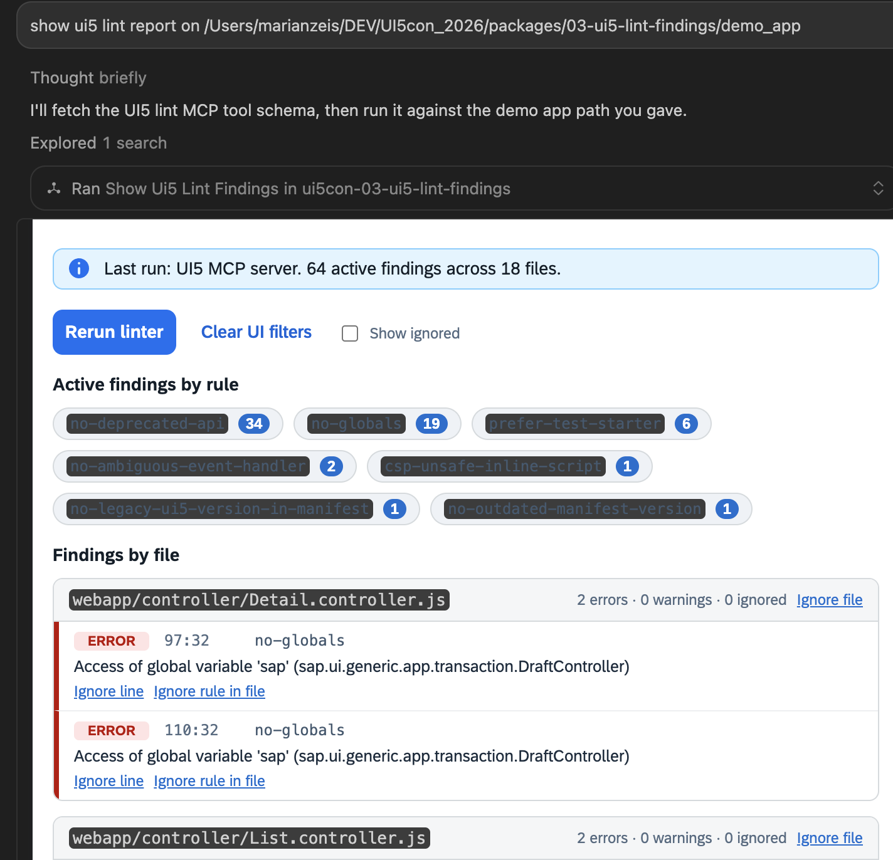

# 03 UI5 Lint Findings

UI5 Web Components MCP App that renders **real UI5 linter output** for a UI5 app. It is the deeper developer-tooling demo: lint findings appear in the chat UI, can be filtered by rule, and can be persisted as real UI5 linter ignores.

The primary live flow uses the official `@ui5/mcp-server` linter and renders its result as a UI5 Web Components MCP App. For a reliable one-step demo, this package opens the MCP App first, then the app calls back to this server to run `@ui5/mcp-server` as a child MCP client. If that is unavailable, it falls back to the local `ui5lint` CLI. There is no fixture fallback.



## What You Will Learn

- How an MCP App can start with a small payload and load live data through a bridge tool call.
- How one MCP server can act as a client of another specialized MCP server.
- How to normalize several upstream result shapes into one stable UI contract.
- How app controls call server tools without asking the model to rebuild the interface.
- How a read-only analysis becomes an explicitly scoped, persistent file change.
- Why text fallback, loading, missing-data, success, and error states all belong in the result
  design.

If sample 00 showed one round trip, this sample shows a complete developer workflow:

```text
model opens app
  -> iframe calls rerun tool
  -> demo server calls official UI5 MCP server
  -> linter result is normalized
  -> iframe filters and displays findings
  -> user chooses a narrow ignore
  -> iframe calls persistence tool
  -> server changes the demo project
  -> iframe reruns the real linter
```

## Tools

- `show_ui5_lint_findings`: opens `ui://ui5-lint-findings/index.html` and renders a real linter report passed in as JSON text. If no JSON is passed, it runs the preferred linter path for `demo_app/` or an optional `projectDir`.
- `apply_ui5_lint_ignore`: writes ignore decisions back to the bundled `demo_app/`.
- `rerun_ui5_linter_demo_app`: local rerun helper used by the MCP App button.

The first is a **UI tool**: its metadata points to the `ui://` resource. The last two are
normal server tools called from inside the already-open app. Reusing one UI resource
means the workflow changes data and state without creating a new iframe for every action.

## Result Modes and the UI Contract

The app switches on `structuredContent.mode` instead of trying to infer state from prose:

| Mode | Meaning |
| --- | --- |
| `autoload` | The UI shell should call the rerun helper after connecting. |
| `report` | A normalized `report` is ready to render. |
| `missing` | No usable linter result was available; show guidance. |
| `ignore-applied` | A persistent ignore was written and updated ignore state is returned. |
| `ignore-error` | The write failed; show the server's error without pretending it succeeded. |

This tagged-result pattern is easier to validate and render than free-form model text. The
`content` field still summarizes every outcome for the model and hosts without MCP Apps.

## Data Flow From Tool Call To UI

1. The MCP host connects to this package.
2. The user asks for lint findings for a UI5 app.
3. In the one-step flow, the model calls `show_ui5_lint_findings` without passing captured JSON.
4. `show_ui5_lint_findings` returns a small `structuredContent` payload with `mode: "autoload"` and declares `_meta.ui.resourceUri`.
5. The host fetches `ui://ui5-lint-findings/index.html` and renders the prebuilt UI5 Web Components app in a sandboxed iframe.
6. `app/src/main.ts` sees `mode: "autoload"` and calls `rerun_ui5_linter_demo_app` through the MCP Apps bridge.
7. `src/register.ts` launches `@ui5/mcp-server` over stdio and calls `run_ui5_linter` with `fix: false` and `provideContextInformation: false`.
8. If `@ui5/mcp-server` cannot start or times out, the server runs `ui5lint --format json` in the same project directory.
9. `src/register.ts` normalizes the linter result into `structuredContent.report` and returns it to the iframe.
10. `app/src/main.ts` receives the report, groups findings by file, supports multi-select rule filters, and sorts findings by active/ignored status, severity, line, column, and rule.
11. Ignore buttons call `apply_ui5_lint_ignore`, which writes a real UI5 linter ignore into `demo_app/`.
12. The current report is filtered immediately so the UI reflects the decision.
13. The rerun button calls `rerun_ui5_linter_demo_app` to rerun the same linter path.

The LLM does not generate the UI. It orchestrates tools and passes data between sibling MCP servers. The UI is fixed application code, while the report data remains flexible.

## UI5 Linter Ignore Model

The real UI5 linter supports persistent ignores in two ways:

- File or directory ignores through `ui5lint.config.*` `ignores` patterns or the CLI `--ignore-pattern` option.
- Inline directives such as `ui5lint-disable`, `ui5lint-enable`, `ui5lint-disable-line`, and `ui5lint-disable-next-line` in supported source files.

The buttons persist ignore decisions with the same mechanisms:

- `Ignore file`: adds the file path to `demo_app/ui5lint.config.cjs` `ignores`.
- `Ignore line`: inserts a `ui5lint-disable-next-line <rule>` directive before the finding line.
- `Ignore rule in file`: inserts a file-level `ui5lint-disable <rule>` directive.

Line and file-rule directives are supported for JavaScript, TypeScript, XML, HTML, and YAML files. JSON files cannot contain comments, so `manifest.json` findings should use `Ignore file`.

After applying an ignore, rerun the linter to verify that future reports respect the change.

The rerun button reads the current project files again. It does not replay the iframe's previous ignore state. If `ui5lint.config.cjs` is deleted manually, rerun will not recreate it; the ignored file appears again because the linter no longer sees the config entry.

## Write Boundary and Safety

Unlike the first three demos, this sample can change files. The write surface is deliberately
narrow:

- The UI can only call the named `apply_ui5_lint_ignore` tool.
- Zod restricts `action` to `file`, `line`, or `fileRule` and validates required fields.
- The server implementation limits persistence to the bundled `demo_app/`.
- The tool returns the changed file and operation so the result is auditable.
- A rerun checks the real linter state instead of trusting an optimistic UI update.

Run the sample in a clean working tree if you want to inspect or discard the generated ignore
changes after the exercise.

## Demo App

`demo_app/` is a small UI5 application used only for this package. When called without captured JSON, `show_ui5_lint_findings` opens the app with an autoload request; the iframe then calls `rerun_ui5_linter_demo_app`, which lints this app through `@ui5/mcp-server` first and `ui5lint` CLI second.

The fallback path expects a `ui5lint` binary on `PATH`. If needed, install it globally:

```bash
npm install --global @ui5/linter
```

Or point the tool at a custom binary:

```bash
UI5_LINTER_BIN=/absolute/path/to/ui5lint npm run start:stdio:03
```

You can also point the preferred MCP path at a custom UI5 MCP command:

```bash
UI5_MCP_SERVER_COMMAND=node UI5_MCP_SERVER_ARGS='["/absolute/path/to/ui5-mcp-server.js"]' npm run start:stdio:03
```

## Files To Read

- `src/register.ts`: tools, resource URI, CSP metadata, persistent ignore tool, and local rerun command.
- `src/lint-findings.ts`: linter JSON normalization, ignore filtering, sorting, summary, and export helpers.
- `src/ignore-writer.ts`: writes `ui5lint.config.cjs` and `ui5lint-disable-*` directives.
- `src/server.ts`: standalone MCP HTTP server for this package.
- `src/stdio.ts`: standalone MCP stdio server for this package.
- `app/src/main.ts`: UI5 Web Components app and MCP Apps bridge calls.
- `demo_app/`: UI5 app used by the rerun tool.

For a beginner-friendly reading order, start with the tool declarations in `src/register.ts`,
then inspect the `autoload` branch in `app/src/main.ts`, the `callServerTool` calls for rerun
and ignore, and finally the normalization and file-writing helpers.

## Run

From the repository root:

```bash
npm run build
npm run start:03
```

MCP endpoint:

```text
http://127.0.0.1:3013/mcp
```

Stdio:

```bash
npm run start:stdio:03
```

Default `start:03` and `start:stdio:03` register `show_ui5_lint_findings` so Cursor can open the UI and run the real linter with one no-argument tool call. The cross-server host flow is also supported by passing separately produced linter JSON text into the same tool.

MCPJam command setup after `npm run build`:

```text
command: node
args: /absolute/path/to/UI5con_2026_MCPApps/dist/packages/03-ui5-lint-findings/src/stdio.js
```

For the live two-server demo, also connect the official UI5 MCP server:

```text
command: npx
args: -y @ui5/mcp-server
```

Prompt example:

```text
Call show_ui5_lint_findings.
```

## What to Try

1. Open the demo and watch the shell transition from `autoload` to a real `report`.
2. Filter by more than one rule and confirm the operation remains entirely client-side.
3. Apply **Ignore line**, inspect the modified source file, then rerun the linter.
4. Apply **Ignore file**, inspect `demo_app/ui5lint.config.cjs`, then rerun.
5. Stop or misconfigure the official UI5 MCP server and observe the local CLI fallback.
6. Remove both linter paths and confirm the app reports a missing/error state rather than
   silently substituting fixture findings.

## Common Problems

- **The app opens but stays in a loading state:** the bridge callback reached the server, but
  the child MCP server or CLI may be unavailable; inspect server stderr and the configured
  command/environment variables.
- **An ignore button changes a real file:** this is intentional. This package is a persistence
  demo, so review `git diff` after experimenting.
- **A `manifest.json` line ignore fails:** JSON cannot contain directive comments; use
  **Ignore file** for JSON findings.
- **The report differs between runs:** the demo runs the real linter over current files. Prior
  ignore actions and dependency/tool versions can legitimately change the result.

Next: [`04-arc1-transport`](../04-arc1-transport/README.md) moves from a local developer tool
to host-orchestrated live SAP data and a confirmation-gated action.
