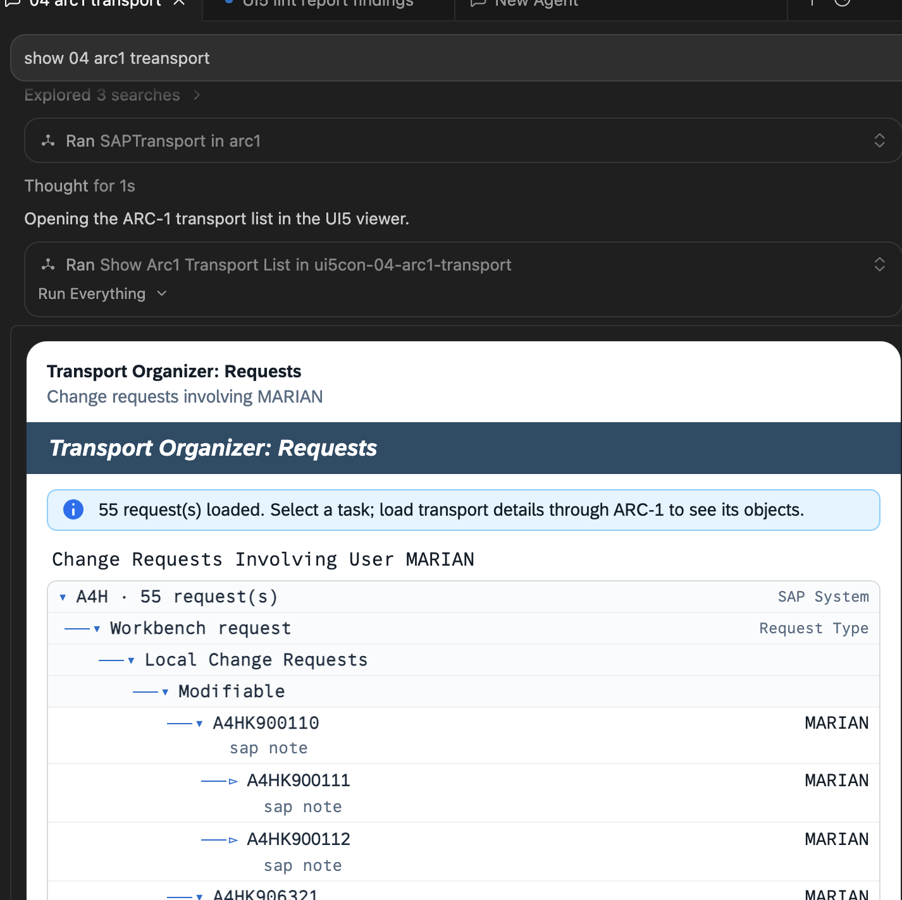

# 04 ARC-1 Transport Organizer

This sample is an SE01/SE10-style UI5 MCP App for live ARC-1 `SAPTransport` data. It shows a
powerful MCP composition pattern: one server specializes in SAP access, while another
specializes in presenting that data. The AI host and model orchestrate the two.



## What You Will Learn

- How a model can pass data from one MCP server into a tool on another server.
- Why the UI server does not need SAP credentials or a direct SAP connection.
- How Zod schemas validate cross-server data at the UI tool boundary.
- How raw external data is normalized into a stable, presentation-oriented contract.
- How an iframe can send a user message back to the host after explicit confirmation.
- How to keep a consequential SAP action behind ARC-1's authorization and write controls.

## The Participants

| Participant | Responsibility |
| --- | --- |
| ARC-1 MCP server | Connects to SAP and executes `SAPTransport` list/get/release actions. |
| This demo server | Validates and normalizes ARC-1 output; serves the prebuilt UI. |
| Model in the host | Chooses the sequence of ARC-1 and visualization tool calls. |
| MCP App iframe | Renders requests, tasks, and objects; collects release confirmation. |
| User | Requests the workflow and confirms any release action. |

This separation is intentional. A visualization package should not duplicate SAP
authentication, transport semantics, or release authorization.

## The Two UI Tools

### `show_arc1_transport_list`

Use this after `SAPTransport action=list summary=true`. It accepts either:

- `transports`, an already-parsed array; or
- `arc1TransportsJson`, raw JSON text as a fallback.

The result uses:

```json
{
  "mode": "list",
  "transports": []
}
```

This is enough to render the request → task hierarchy, but list summaries may not contain the
repository objects inside each task.

### `show_arc1_transport`

Use this after `SAPTransport action=get` for one request. It accepts parsed or raw detail and
optionally the list result, then returns:

```json
{
  "mode": "review",
  "transports": [],
  "review": {
    "transport": {},
    "tasks": [],
    "objects": [],
    "summary": {}
  }
}
```

Including the earlier list keeps the full organizer tree visible while the selected request
has richer task and object details.

Both tools point to the same resource:

```text
ui://arc1-transport/index.html
```

The iframe changes its view from `structuredContent.mode`; it is not a different app for list
and detail.

## Read Flow: SAP to the MCP App

1. The user asks to inspect transports.
2. The model calls ARC-1 `SAPTransport` with `action=list` and `summary=true`.
3. ARC-1 reads SAP and returns transport data to the host.
4. The model passes that data into `show_arc1_transport_list`.
5. This server validates and normalizes status, task counts, and list hierarchy.
6. The host reads `ui://arc1-transport/index.html` and opens the UI5 Web Components app.
7. The bridge delivers `{ mode: "list", transports }` to the iframe.
8. The UI renders an SAP system → request type → status → request → task tree.
9. For object-level detail, the model calls ARC-1 `SAPTransport action=get` for a request.
10. The model passes the detail and optional list data into `show_arc1_transport`.
11. The same iframe resource renders a review and lets the user open a task object page.

Notice that the model is a data router here. It should not paraphrase the ARC-1 data into an
unvalidated shape; the UI tool schemas define the accepted contract.

## Release Flow: Confirmation Back to ARC-1

The **Release Task** button does not call SAP and does not call an unprotected release helper
on this UI server.

1. The user selects a modifiable task and clicks **Release Task**.
2. The app opens a confirmation dialog containing the task ID.
3. After confirmation, the app calls `app.sendMessage(...)` through the MCP Apps bridge.
4. The host receives a new user-role message stating that the release was explicitly
   confirmed and asking the agent to use ARC-1 `SAPTransport`.
5. The model can then call ARC-1, whose normal authorization and write controls still apply.
6. After success, the model should fetch the parent request again and refresh the UI tool.

This is a useful distinction for new MCP App developers:

- `callServerTool` invokes a named tool directly through the host.
- `sendMessage` returns control to the conversation so the model can orchestrate another
  server.

The demo uses `sendMessage` because ARC-1 is a separate server and owns the write operation.

## Files to Read in Order

1. `src/register.ts` — input schemas, UI tools, missing-data handling, and resource metadata.
2. `src/arc1-transport.ts` — ARC-1 JSON parsing, normalization, labels, summaries, and UI types.
3. `app/src/main.ts` — list/review rendering, task navigation, confirmation, and `sendMessage`.
4. `app/index.html` — organizer page, task page, and release dialog shell.
5. `app/src/styles.css` — SE01-style hierarchy and responsive task layout.
6. `src/stdio.ts` and `src/server.ts` — standalone launchers.

## Build and Configure

From the repository root:

```bash
npm run build
```

Configure this UI server in Cursor or MCPJam:

```text
command: node
args: /absolute/path/to/UI5con_2026_MCPApps/dist/packages/04-arc1-transport/src/stdio.js
```

Also connect ARC-1 using its own server configuration and SAP credentials. Those credentials
belong to ARC-1, not to this package.

For an HTTP-capable client, start only this UI server with:

```bash
npm run start:04
```

Endpoint:

```text
http://127.0.0.1:3014/mcp
```

## Prompt for the Full Demo

In Claude Desktop, enable both ARC-1 and this UI server and start a fresh chat first.

Use this prompt in Cursor or Claude Desktop. It performs only ARC-1 read actions and makes the
final UI-producing call explicit:

```text
Perform these tool calls in order and do not stop after summarizing the ARC-1 result:

1. Call ARC-1 SAPTransport with action="list", summary=true, and status="D".
2. From the returned JSON array, select the first modifiable request that has at least one task
   and an objectCount greater than 0.
3. Call ARC-1 SAPTransport with action="get" and id set to that request ID.
4. Call show_arc1_transport. Pass the parsed list array as "transports" and the parsed detail
   object as "transport".

The final action must be show_arc1_transport. Do not call any ARC-1 write action.
```

For a list-only first step:

```text
List my open SAP transports with ARC-1, then render the result with
show_arc1_transport_list.
```

## What to Observe

1. The primary ARC-1 result is live system data. `demo-data/` contains a clearly labelled,
   deterministic offline rehearsal fixture for stage recovery; it is not presented as live SAP.
2. The UI server's `_meta.source.kind` records that the payload is host-orchestrated ARC-1
   data.
3. A list result can show tasks but may need `action=get` before it can show their objects.
4. Selecting a task is local UI navigation and does not call the model.
5. Release requires a visible confirmation and then returns to the agent instead of bypassing
   ARC-1.
6. After a real write, the UI is only current after fresh SAP data is read and rendered.

## Common Problems

- **The UI says it is waiting for ARC-1 data:** this UI server cannot fetch SAP by itself.
  Call ARC-1 first and pass its output to the appropriate visualization tool.
- **The request tree appears but objects are empty:** list summaries are not full details; call
  ARC-1 `action=get` and use `show_arc1_transport`.
- **Release sends a message but nothing changes in SAP:** sending the message is only the
  confirmed request. The host/model must still call ARC-1 and handle its response.
- **The release button is disabled:** the normalized task status is not modifiable/releasable.
- **The model mangles a large JSON result:** prefer passing parsed structured data when the
  host supports it; the raw JSON input exists as a compatibility fallback.
- **ARC-1 or SAP is unavailable during a rehearsal:** read `demo-data/transport-list.json` and
  `demo-data/transport-detail.json`, then pass both into `show_arc1_transport`. Tell the
  audience explicitly that the data is the offline fixture.

Return to the repository-wide [`LEARNING.md`](../../LEARNING.md) to review the shared MCP Apps
architecture and safety rules.
